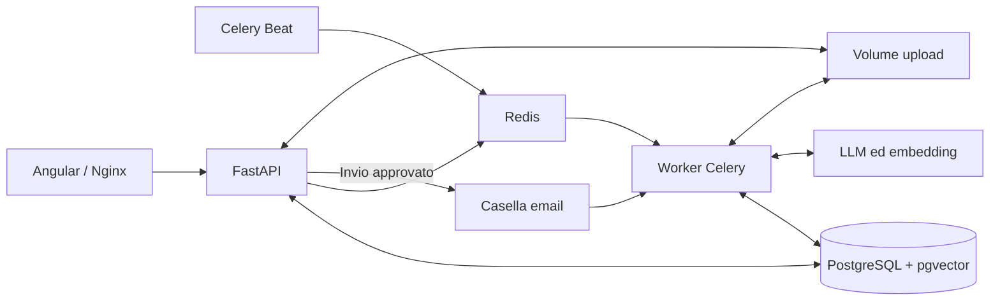

# ARCHITECTURE

## Scopo e componenti

Unical Support acquisisce email, le classifica, recupera informazioni dalla Knowledge Base e prepara risposte che un operatore può modificare e approvare. La generazione non invia automaticamente il messaggio. Le richieste prive di informazioni sufficienti passano alla revisione umana.

| Componente | Responsabilità | Codice di riferimento |
| --- | --- | --- |
| Angular 18 | Login, Review Hub, Documenti, Categorie, Impostazioni e Segnalazioni | `frontend/src/app/` |
| FastAPI / SQLAlchemy | API autenticate, permessi, transazioni e invio approvato | `app/api/`, `app/services/` |
| Celery worker | Polling, agenti e ingestione documentale | `app/tasks/` |
| Celery Beat | Polling ogni 2 minuti, recupero job ogni 15 minuti | `app/core/celery_app.py` |
| PostgreSQL 16 + pgvector | Dati applicativi, configurazione modelli ed embedding | `app/models/`, `app/ai/rag.py` |
| Redis 7 | Broker, risultati Celery e coordinamento del polling | `app/services/email_polling_service.py` |
| Nginx | Frontend statico, proxy `/api/` e `/static/` in produzione | `frontend/nginx.conf` |

## Dati e persistenza

Le entità principali sono utenti, email, categorie, documenti, impostazioni AI, segnalazioni e blacklist dei token. Email e documenti possono avere più categorie. Le impostazioni AI sono una configurazione singleton modificabile dalla dashboard. I campi di audit registrano creazione, modifica e relativo autore.

Il database contiene anche `langchain_pg_collection` e `langchain_pg_embedding`, gestite da LangChain. Alembic le esclude dall'autogenerazione delle rimozioni: non sono tabelle da cancellare perché assenti da `Base.metadata`.

I volumi Compose sono `postgres_data` (database e vettori), `shared_uploads` (file condivisi fra API e worker) e `celerybeat_data` (stato dello scheduler). Il nome Docker effettivo dipende dal progetto Compose. Il deploy rileva e riutilizza i nomi esistenti. Redis nel Compose corrente non ha un volume persistente: non va ricreato durante un aggiornamento applicativo, perché si perderebbero code e coordinamento in memoria.

## Acquisizione e lavorazione delle email

`get_email_client()` seleziona Gmail API oppure IMAP/SMTP. Il polling automatico e il pulsante “Controlla nuove email” condividono una prenotazione Redis di 660 secondi; il job conserva lo stato per 24 ore. La lettura e la generazione sono asincrone: il completamento dell'acquisizione non implica che tutte le bozze siano già pronte.

La pipeline principale attraversa `TO_CLASSIFY` → `TO_RESPOND` → `DRAFT`; può terminare in `ESCALATED`, `IGNORED` o `FAILED`. `SENT` deriva dall'approvazione e dall'invio. Le code separate sono `polling_queue`, `classify_queue`, `respond_queue` e `document_queue`.

Ogni tentativo AI acquisisce una prenotazione SQL con `processing_token`, `processing_started_at` e `processing_generation`. I tool sono vincolati all'email e alla prenotazione tramite closure; il token non è un parametro a disposizione del modello. Task duplicati, generazioni precedenti e bozze passate all'operatore non possono scrivere. Limiti del task: 540 secondi soft e 600 hard; scadenza della prenotazione: 660 secondi.

Lo sweeper recupera solo lavori nelle fasi di elaborazione con prenotazione scaduta oppure mai acquisiti da almeno 15 minuti. Pubblica dopo il commit, incrementando la generazione. Non rigenera bozze revisionate, email inviate o bozze in attesa di revisione.

Il client corrente invia `expected_revision` quando salva; il backend controlla `draft_revision` sotto lock SQL e risponde 409 se il testo remoto è cambiato. Il salvataggio manuale imposta `manually_edited` e invalida i vecchi job. Per retrocompatibilità `expected_revision` è opzionale nei contratti: i vecchi client che lo omettono non ottengono il controllo ottimistico completo.

## Review Hub: date, pagine e revisioni

Gmail fornisce `internalDate`, IMAP `INTERNALDATE`; seguono come fallback il Date dell'email e l'istante di acquisizione UTC. Le righe storiche usano `created_at`, senza pretendere che sia la data originale del provider.

`GET /api/emails/page` ordina per `received_at DESC, id DESC`, accetta `q`, `status` e `limit` (1–100), e restituisce `items`, `next_cursor`, `total` e `counts`. Il cursore contiene data e UUID: i nuovi arrivi non spostano i confini delle pagine come accadrebbe con offset. Il vecchio `GET /api/emails/` mantiene la risposta ad array.

La dashboard carica pagine da 50, cerca sul server e raggruppa per giorno Europe/Rome. Un IntersectionObserver nella lista attiva la pagina successiva; rimane un pulsante accessibile per caricamento o riprova. Le intestazioni sono sticky. Il refresh ogni cinque secondi aggiorna la finestra caricata e scarta le risposte obsolete.

Il dettaglio mantiene uno snapshot indipendente dalla lista. Uscire dal filtro o dalla pagina non lo chiude. Le modifiche remote producono un avviso; l'operatore può caricarle oppure mantenere esplicitamente il proprio testo. Il conflitto non cancella la bozza locale. Guard di navigazione e beforeunload avvisano in presenza di modifiche non salvate.

`POST /api/emails/{id}/retry` riaccoda un errore di elaborazione compatibile con la revisione attesa. `POST /api/emails/retry-failed` gestisce fino a 100 errori per chiamata, supporta `exclude_ids` e restituisce conteggi. La dashboard esclude l'email aperta. Bozze manuali e fallimenti di consegna sono protetti: “Riprova invio” usa il testo approvato e non richiama l'AI.

## Knowledge Base e AI

L'upload richiede un file locale e accetta `reference_url` HTTP(S) opzionale, nullable. Non esiste più l'ingestione da pagina web. `PUT /api/documents/{id}` aggiorna categorie e link: omettere il campo lo conserva, `null` o stringa vuota lo rimuove.

Il worker estrae il file con Unstructured, lo normalizza in Markdown tramite il modello del responder a temperatura zero e verifica la fedeltà dei dati. Un documento non affidabile diventa `needs_review` e non viene indicizzato; gli stati previsti includono `pending` e `indexed`. I file temporanei di estrazione vengono rimossi: `extracted_text` non è una copia integrale garantita dell'originale, e gli originali importanti vanno conservati anche fuori dall'applicazione.

I paragrafi formano i chunk; paragrafi molto lunghi usano uno splitter di fallback. I metadati includono `document_id`, categorie, nome e link della fonte. Gli embedding correnti sono `models/gemini-embedding-2` di Google. La ricerca filtra i documenti per categorie applicative; “Generale” comprende anche quelli senza categoria. FlashRank riordina i candidati; normalmente si selezionano 4 frammenti fra 12 candidati.

Il retrieval usa il link corrente della tabella documenti, anche se i metadati vettoriali sono precedenti. Comunica `reference_url` e `citation_allowed`. Un documento senza link valido può fornire fatti, ma non viene citato con un nome isolato o un URL inventato. I tool di salvataggio rifiutano link non recuperati e richiedono una precedente ricerca con fonti utilizzabili.

Classifier e responder usano LangGraph/LangChain. I provider configurabili sono Groq, Google e un endpoint locale compatibile OpenAI. La configurazione effettiva proviene dal database; i default nel codice sono fallback. Il worker di produzione usa la rete host per raggiungere il tunnel LLM già presente sulla macchina. Il deploy non avvia né riconfigura quel tunnel.

Le risposte sono generate dinamicamente: non ci sono template testuali precompilati. La lingua è la prima riconoscibile nel corpo corrente, senza influenza dell'oggetto, delle firme o dei messaggi citati. Il prompt richiede una sola lingua, concisione, tono cordiale e paragrafi senza hard wrapping. I nomi propri e i titoli ufficiali possono mantenere la forma originale. Il fallback linguistico resta configurabile quando la lingua non è identificabile.

`ai_confidence` è la media dei punteggi disponibili del reranker nel tentativo di risposta, non una probabilità calibrata di correttezza. È nullable; la UI mostra N/D se assente e 0% se il valore è zero. Verde da 0.8, ambra da 0.5, rosso sotto 0.5; N/D in indaco.

## Rendering e invio

La bozza resta testo semplice. `normalize_email_text` unisce i ritorni singoli accidentali e preserva paragrafi ed elenchi. `email_renderer.py` esegue escaping HTML e trasforma gli URL HTTP(S) in link.

L'email istituzionale ha logo locale, accento Unical `#B61918`, contenitore da 640 px, misura del testo massima di 72ch, Arial 16 px e interlinea 1.65. La nota AI supervisionata è in alto, dopo il logo e prima del saluto, in un riquadro grigio tenue con testo piccolo in corsivo. La lingua e il disclaimer separati sono salvati nell'email; le vecchie note riconosciute vengono trattate in rendering senza riscrivere tutte le righe storiche.

L'invio usa `multipart/alternative`, testo semplice e HTML con logo PNG inline CID; conserva i riferimenti al messaggio originale e, su Gmail API, il threadId. SMTP mantiene gli header di threading; l'accorpamento finale dipende dal client di posta.

`POST /api/emails/{id}/preview` rende il testo corrente con lo stesso servizio, senza salvare né inviare. Nella preview il logo è incorporato come data URI; iframe sandbox e CSP bloccano script, connessioni e form. Il frontend misura l'altezza per evitare scrollbar interne.

## Design system e autenticazione

Angular usa componenti standalone e Signals, guard delle rotte protette e client generato OpenAPI. La rotta canonica è `/review`; `/review-hub` rimane un redirect. L'autenticazione usa JWT access/refresh e blacklist per l'invalidazione. Non sono presenti credenziali di accesso predefinite documentate: gli utenti vengono creati con `create_user.py`.

L'interfaccia è italiana, con rosso Unical, superfici neutre e icone Hugeicons Stroke Rounded. Icone stroke 1.75 e azioni medium 500 bilanciano i pesi. I drawer hanno un separatore sinistro da 2 px; sui telefoni il dettaglio diventa dialog con gestione focus, Escape e sfondo inerte.

“Segnalazioni” è nella sidebar; il footer mostra il nome prima di `@`. Le textarea crescono con il contenuto, i toast hanno superfici colorate semitrasparenti e i mittenti mostrano il nome con indirizzo secondario quando manca. Le preferenze di contrasto, densità, lettura e movimento sono persistite in `unical-support.theme.v1`. Il catalogo `/design-system` è pubblico e dimostrativo, senza azioni backend.

## Limiti operativi

La protezione delle bozze riduce le race condition identificate nel codice; non esiste una traccia che permetta di ricostruire con certezza l'episodio originario. Il prompt e i controlli delle fonti non costituiscono una verifica fattuale completa: l'approvazione umana resta parte del flusso. I documenti `needs_review`, il tunnel LLM, i token OAuth e gli errori di indicizzazione richiedono monitoraggio operativo.
